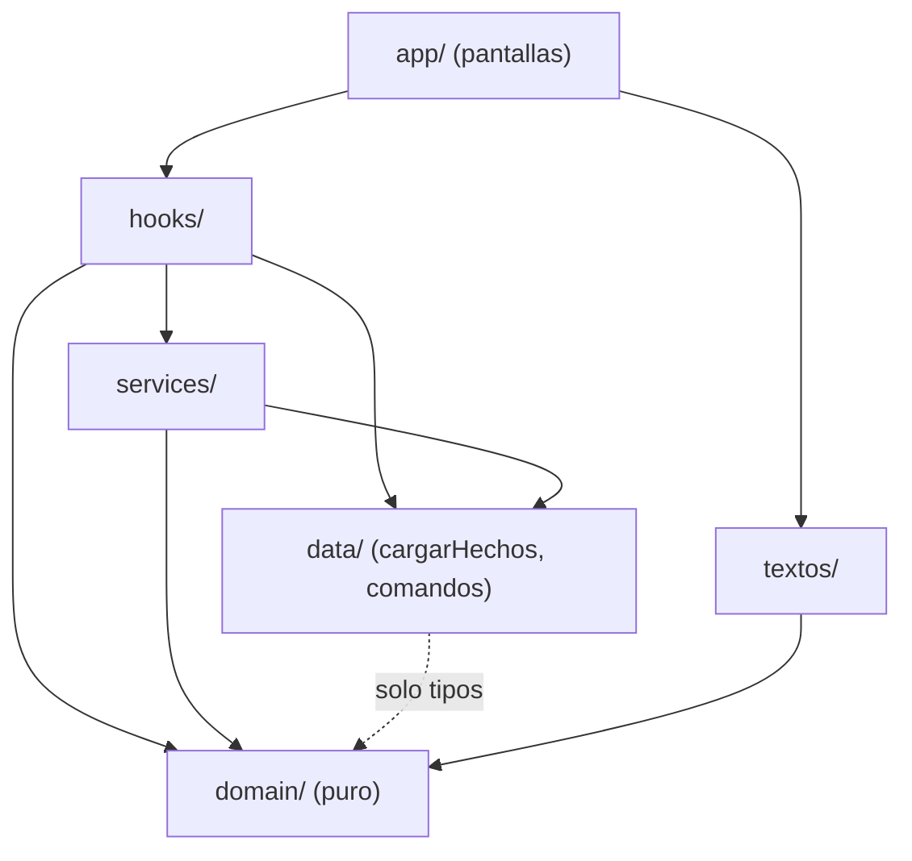
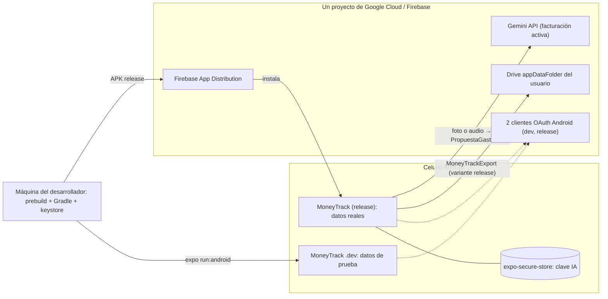
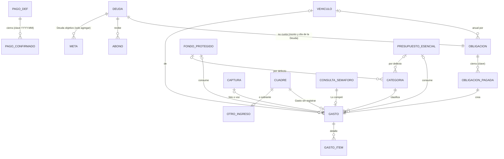

# Architecture Spine — MoneyTrack v1

Los términos con mayúscula son los del Glosario del PRD (§3) y se usan igual en código, pruebas e historias.

> **Cambio de rumbo (2026-11-11).** El MVP se reduce a capturar Gastos con IA y ver el resumen del mes ([Sprint Change Proposal](../../sprint-change-proposal-2026-11-11.md)). Cambian AD-1 (nota), AD-11, AD-19 y AD-22. Las decisiones listadas en **Congelado en el MVP** siguen vigentes como diseño, pero ninguna historia del MVP las implementa.

## Design Paradigm

**Núcleo funcional / cáscara imperativa, local-first.** Un núcleo puro (`domain/`) calcula todas las cifras a partir de los hechos guardados y de la fecha de hoy. La cáscara (pantallas, persistencia, servicios del teléfono y de la nube) captura hechos, los guarda y muestra lo que devuelve el núcleo. La base SQLite del celular es siempre la fuente de verdad; la nube (IA, Drive) es un adaptador opcional.

| Capa | Carpeta | Hace | Nunca |
| --- | --- | --- | --- |
| Pantallas | `src/app/` (Expo Router) | Mostrar y capturar; ejecutar comandos con `ejecutar()` | Calcular cifras, usar Drizzle, llamar a la red |
| Hooks | `src/hooks/` | `useHoy`, `useEstado`, `useComando`: unir `data/` + `domain/` + `services/` | Lógica de negocio propia |
| Persistencia | `src/data/` | Esquema Drizzle, migraciones, `cargarHechos`, comandos de escritura | Calcular cifras derivadas |
| Servicios | `src/services/` | Reloj, extractor, notificaciones, biometría, exportación/respaldo, log | Escribir en la base salvo vía comandos de `data/` |
| Núcleo | `src/domain/` | Tipos de `Hechos` y `Estado`; funciones puras: hechos + `hoy` → cifras | Importar React, Expo, Drizzle, SQLite, la red; usar `Date` o `Math.random` |



`domain/` no depende de nadie. `data/` solo importa **tipos** de `domain/`.

## Invariants & Rules

### AD-1 — Un solo cálculo, puro [ADOPTED]

- **Binds:** FR-10, FR-13, FR-16, FR-18, FR-19, FR-20, FR-22, FR-23, todas las pantallas
- **Prevents:** pantallas o Semáforo que calculan el Dinero libre, las Reservas o el Ritmo de la Meta cada uno a su manera.
- **Rule:** `domain/` expone `calcularEstado(hechos, hoy): Estado`, que devuelve **todas** las cifras derivadas: Saldo calculado, Reservas por tipo, saldo de cada Deuda, Saldo proyectado por día del Horizonte, Dinero libre (con el día y el monto del mínimo), Meta (o `null`), Día de Libertad, saldos de Fondos protegidos y de Presupuestos esenciales, ocurrencias pendientes y vencidas, y Pagos atrasados. El Semáforo (`evaluarCompra(estado, precio, fondoId?)`, que devuelve `{color, r, dineroLibreResultante, impactoEnDias, comeReservaMeta}`) y `impactoEnDias(estado, monto)` solo leen un `Estado`. Las cifras que pueden faltar datos se devuelven como `{valor, aproximado}`: saldo de Deuda, Avance, Ritmo, Fecha de la Meta proyectada y Día de Libertad. Saldo calculado, Dinero libre e Impacto en días nunca son aproximados. No hay una bandera global. `domain/` es total: no lanza excepciones ante hechos válidos. ESLint lo hace cumplir con `no-restricted-imports` y `no-restricted-globals`/`no-restricted-syntax` para `Date` y `Math.random` en `src/domain/**`. `calcularEstado` con 12 meses de datos tarda < 200 ms (hay una prueba que lo mide).
- **MVP (2026-11-11):** Inicio no muestra el `Estado` de Dinero libre. Usa la función pura `domain/resumenGastos(gastos, mes)`, que devuelve el total del mes, el gasto por categoría (de mayor a menor) y los últimos Gastos. Sigue la misma regla: pura, total, sin `Date`; las pantallas no suman cifras por su cuenta. `calcularEstado` se conserva para cuando se descongele.

### AD-2 — Solo se guardan hechos; lo derivado nunca se persiste [ADOPTED]

- **Binds:** todo `data/`, FR-1..FR-5, FR-12, FR-17, FR-26
- **Prevents:** saldos o Reservas guardados que se desincronizan al editar o borrar; puntos de partida que cada historia inventa a su manera.
- **Rule:** la base solo contiene **configuración** y **movimientos**. Ninguna columna guarda lo que `calcularEstado` puede derivar: ni el saldo de una Deuda, ni el de un fondo, ni Reservas, ni Dinero libre, ni fechas proyectadas, ni estados como "vencida" o "adelanto".
  - **Puntos de partida:** son configuración con fecha. Incluyen `saldoInicial {monto, fecha}`, `fondo.saldoInicial`, `obligacionAnual.reservaInicial` y `deuda.saldoInicial` con su fecha. Para calcular solo cuentan los movimientos con fecha igual o posterior a la del punto de partida.
  - **Instantáneas (excepción única):** el Cuadre (FR-15) y la consulta del Semáforo (FR-24) guardan los números de su momento solo como historia. `domain/` nunca los lee como entrada. Si después se borra el Gasto de un "Lo compré", la consulta no cambia.

### AD-3 — Escrituras solo por comandos, transaccionales y con rastro [ADOPTED]

- **Binds:** FR-1..FR-7, FR-9, FR-11, FR-12, FR-14, FR-17, FR-20, FR-21, FR-26
- **Prevents:** un "ya pagamos" que crea el Gasto pero no vincula la cuota; transacciones anidadas; ediciones sin rastro o con formas distintas.
- **Rule:**
  - **Módulo dueño:** cada tabla tiene un único módulo dueño en `src/data/tablas/` que exporta `insertarX(tx, …)`, `editarX(tx, …)` y `borrarX(tx, …)`. Esas funciones reciben la transacción y nunca la abren.
  - **Comandos:** cada comando de `src/data/commands/` (p. ej. `registrarGasto`, `marcarObligacionPagada`, `confirmarPago`, `hacerCuadre`, `registrarAbono`, `fijarMeta`) abre **una** transacción y compone funciones de los módulos dueños. No existen comandos genéricos como `editarMovimiento`.
  - **Borrado en cascada:** al borrar un Gasto que nació de una Obligación pagada, un Cuadre o una consulta, se borra en la misma transacción la fila que lo originó (salvo la instantánea de la consulta, que queda igual).
  - **Rastro:** toda edición o borrado de cualquier tabla, configuración incluida, escribe en `rastro` con la forma `{id, entidad (tabla), entidadId, operacion ∈ editar|borrar|restaurar, antes (fila completa en JSON), despues (fila completa en JSON o null), fecha}`. La función pura `domain/diferencias(antes, despues)` arma el texto visible.
  - **Lint:** ESLint prohíbe importar `drizzle-orm` y `src/data/tablas` fuera de `src/data/`.

### AD-4 — Correcciones retroactivas visibles [ADOPTED]

- **Binds:** FR-12, FR-14, FR-15
- **Prevents:** ediciones que reescriben la historia en silencio; Cuadres viejos que cambian de valor.
- **Rule:**
  - Editar o borrar recalcula todo como si siempre hubiera sido así (AD-2) y deja el rastro visible desde el movimiento ("editado 15-oct: 850.000 → 85.000").
  - Borrar es lógico (`deletedAt`).
  - Los Cuadres pasados conservan su diferencia.
  - Si se registra un Gasto con fecha anterior al último Cuadre, la app avisa que pudo haber quedado contado también en el Gasto sin registrar. No lo corrige sola.

### AD-5 — Ocurrencias derivadas, Periodos y bordes de calendario

- **Binds:** FR-1..FR-3, FR-11, FR-13, FR-25..FR-27
- **Prevents:** dos historias que materializan "la Obligación de noviembre" de forma distinta; pendientes fantasma; la cuota de una Deuda guardada en dos tablas.
- **Rule:**
  - **Ocurrencias:** las ocurrencias de Pagos, Obligaciones y cuotas **no se guardan**; `domain/` las genera desde su definición. Un hecho que cierra una ocurrencia la referencia como `(definicionId, clave)`, donde `clave` es `YYYY-MM` (mensual) o `YYYY` (anual), y esa pareja es única. Por defecto se asigna a la ocurrencia abierta más antigua y el usuario puede cambiarla.
  - **Fechas:** un día que no existe en el mes pasa al último día del mes. No hay ajuste por fines de semana.
  - **Cuotas de Deuda:** son Obligaciones mensuales con `deudaId` que **no guardan monto ni día propios**: los leen de la Deuda.
  - **Horizonte:** de `hoy` a `hoy+31`, ambos inclusive.
  - **Atrasos:** un Pago esperado vencido sin confirmar se proyecta en `hoy` y se marca `pagoAtrasado`. Una Obligación vencida sin pagar se descuenta en `hoy`.

### AD-6 — Amortización francesa con tasa normalizada

- **Binds:** FR-2, FR-16, FR-17, FR-26
- **Prevents:** dos repartos distintos entre capital e interés y, con ellos, dos saldos de Deuda y dos Días de Libertad.
- **Rule:**
  - **Saldo:** saldo de una Deuda = saldo inicial − capital de las cuotas pagadas − Abonos. Siempre lo calcula `domain/`.
  - **Interés y capital:** interés del mes = saldo × tasa mensual. Capital de una cuota pagada = monto del Gasto vinculado − interés del mes, con mínimo 0. Si se paga más de la cuota, el exceso no es un Abono; para abonar se registra un Abono.
  - **Tasa:** se captura con su tipo, `EA` (por defecto) o `MV`, y se guarda tal como se ingresó. `domain/` la normaliza a mensual con `(1+EA)^(1/12) − 1`.
  - **Proyecciones:** las cuotas futuras se proyectan por su monto programado.
  - **Sin tasa:** toda la cuota es capital y las cifras de esa Deuda quedan `aproximado`.

### AD-7 — Dinero en enteros, redondeo nunca a favor [ADOPTED]

- **Binds:** todo; PRD §8 Honestidad, Moneda
- **Prevents:** errores de punto flotante y redondeos que inflan lo disponible.
- **Rule:**
  - Todo monto es un entero de pesos.
  - Lo intermedio con fracciones (interés, prorrateo, Ritmo) se redondea **en contra del usuario**: lo que se reserva o se debe, hacia arriba; lo disponible, hacia abajo; el Impacto en días, hacia arriba.
  - El texto de un monto sale solo de `formatearDinero()`, con punto como separador de miles.

### AD-8 — Fechas sin hora; un solo "hoy" [ADOPTED]

- **Binds:** todo `domain/`, `data/`, formularios, notificaciones
- **Prevents:** desfases de un día por zona horaria o por cruzar la medianoche con la app abierta; pruebas que dependen del reloj.
- **Rule:**
  - **Formatos:** las fechas de negocio son `YYYY-MM-DD`. Las marcas técnicas (`createdAt`, `updatedAt`, `deletedAt`, rastro) son ISO 8601 en UTC.
  - **Origen de "hoy":** `services/reloj` expone `hoy()`, calculado en `America/Bogota`, y `suscribirHoy(cb)`, que avisa al cruzar la medianoche de Bogotá y cuando la app vuelve a primer plano.
  - **Uso:** `useHoy()` es el único hook que envuelve el reloj. `useEstado`, las fechas por defecto de los formularios y `reprogramar` lo usan, y ningún componente guarda `hoy` en memoria.

### AD-9 — Nada personal en el código; categorías como reglas [ADOPTED]

- **Binds:** FR-1..FR-5, FR-7, FR-8, FR-22, FR-25; puerta a otros usuarios
- **Prevents:** valores del autor incrustados en el código; dos fuentes de la clasificación por defecto; enlaces por nombre que se rompen al renombrar.
- **Rule:**
  - **Configuración:** Pagos, Colchón, umbral del Semáforo, Fondos protegidos, Presupuestos esenciales, Vehículos, categorías y horas de la Sesión de pagos son filas de configuración. El modelo admite N Fondos y N Presupuestos.
  - **Siembra:** la v1 siembra los valores del PRD. La única constante permitida en el código es ese valor de siembra.
  - **Reglas FR-8:** son columnas de `categorias`: `claseDefault`, `presupuestoId?`, `fondoId?`, `requiereVehiculo` y `esSistema`. No existe otra tabla de reglas.
  - **Enlaces:** todo enlace a una categoría es por `categoriaId`. La categoría de sistema "Sin registrar" no se puede borrar.

### AD-10 — Datos listos para sincronizar [ADOPTED]

- **Binds:** todas las tablas, respaldo
- **Prevents:** reescribir la base el día que haya cuentas o varios dispositivos; choques de ids entre copias.
- **Rule:** toda tabla tiene `id` UUID v4 generado en el cliente con `expo-crypto` `randomUUID()`, más `createdAt`, `updatedAt` y `deletedAt`. No se usan ids autoincrementales ni claves naturales como clave primaria.

### AD-11 — Extractor de facturas y notas de voz detrás de un contrato único [ADOPTED]

- **Binds:** FR-7, FR-8, FR-31, FR-32; PRD §8 Privacidad, Sin conexión
- **Prevents:** pantallas acopladas a un proveedor; respuestas con formas distintas para foto y voz; Gastos guardados sin confirmar; categorías inventadas por la IA.
- **Rule:**
  - **Contrato:** `services/extractor` expone dos funciones con la misma salida:
    - `extraerFactura(fotoUri, categorias: {id, nombre}[]): Promise<Resultado<PropuestaGasto>>`
    - `extraerNotaDeVoz(audioUri, categorias: {id, nombre}[], hoy): Promise<Resultado<PropuestaGasto>>` (`hoy` permite resolver "ayer" o "el lunes").
  - **Esquema único (Zod):** `PropuestaGasto { monto: entero | null, comercio: string | null, fecha: YYYY-MM-DD | null, categoriaId: string | null, items: {descripcion, monto: entero | null}[] }`. Un `categoriaId` que no está en la lista recibida se convierte en `null`. La Clase no se sugiere: se copia de la categoría al registrar (AD-19).
  - **Entrada directa:** Gemini recibe la imagen o el audio directamente (sin OCR ni transcripción previa en el celular).
  - **Propuesta, no Gasto:** la salida solo alimenta la pantalla de confirmación. Nunca se guarda como Gasto sin el comando `registrarGasto`.
  - **Tiempo límite:** 10 s para la foto y 15 s para la voz; al vencer aborta con `timeout`, el usuario completa a mano y la captura queda en la cola (AD-22).
  - **Proveedor:** vive en un único adaptador. Es `gemini-3.8-flash` con facturación de Cloud activa, porque así no entrena con los datos. El id del modelo es un ajuste del adaptador.

### AD-12 — Secretos fuera de la base y del respaldo [ADOPTED]

- **Binds:** AD-11, AD-14, PRD §8 Privacidad
- **Prevents:** claves o tokens filtrados en el repositorio, el APK, la exportación, Drive o el log.
- **Rule:** la clave de la API de IA la ingresa el usuario y vive solo en `expo-secure-store`. Los tokens de Google los maneja la librería de inicio de sesión. Ningún secreto va en el código, `app.config.ts`, SQLite, la exportación, el respaldo ni el log. Un proxy futuro solo reemplaza el adaptador de AD-11.

### AD-13 — Notificaciones derivadas de los datos [ADOPTED]

- **Binds:** FR-14, FR-25, FR-27
- **Prevents:** avisos duplicados o de Obligaciones borradas; programación dispersa.
- **Rule:**
  - **Único punto de programación:** `services/notificaciones.reprogramar(estado, hoy)` es lo único que programa notificaciones locales (`expo-notifications`). Cancela todas y las recrea desde el `Estado`: Sesión de pagos, recordatorio de Cuadre al día siguiente y vencimientos anuales a 30 y 7 días.
  - **Cuándo se llama:** solo desde `ejecutar()` (AD-18), al abrir la app y desde `suscribirHoy`.
  - **Privacidad:** los textos de las notificaciones no muestran montos.

### AD-14 — Exportación y respaldo: instantánea versionada, restaurar reemplaza

- **Binds:** PRD §8 Respaldo; puerta a otros usuarios
- **Prevents:** formatos de exportación distintos; restauraciones que mezclan datos o dejan conexiones muertas; respaldos de prueba que pisan los reales.
- **Rule:**
  - **Formato único:** `MoneyTrackExport { schemaVersion, variante, exportadoEn, tablas }`. Es JSON de todas las tablas de AD-2, con filas borradas y rastro incluidos, y sin secretos ni fotos. `schemaVersion` es el número de migraciones de drizzle-kit aplicadas.
  - **Dos destinos, mismo formato:** la exportación manual a archivo y el respaldo automático a Google Drive. El respaldo es opcional y usa `appDataFolder` con el archivo `moneytrack-<variante>-<exportadoEn>.json`.
  - **Respaldo automático:** sube una copia al pasar a segundo plano si `max(updatedAt)` de todas las tablas es posterior a la última copia. Conserva las últimas 7 de su variante.
  - **Restaurar:** rechaza copias de otra variante o con `schemaVersion` mayor. Una copia con `schemaVersion` menor se migra primero en una base temporal en memoria. Luego, en una sola transacción sobre la conexión abierta, borra todas las tablas e inserta las de la copia. Nunca reemplaza el archivo `.db`. Al terminar pasa por el post-comando de AD-18.

### AD-15 — Acceso protegido [ADOPTED]

- **Binds:** PRD §8 Privacidad
- **Prevents:** que alguien con el celular desbloqueado entre a las finanzas.
- **Rule:** al abrir la app, y al volver tras más de 5 minutos en segundo plano, se exige `expo-local-authentication` (biometría o el bloqueo del teléfono) antes de mostrar cualquier pantalla con datos. La base no se cifra aparte en v1.

### AD-16 — Native generado y variantes separadas [ADOPTED]

- **Binds:** compilación, distribución, AD-14, AD-24
- **Prevents:** cambios nativos a mano que se pierden en el siguiente `prebuild`; pruebas que tocan las finanzas reales.
- **Rule:**
  - **Carpeta nativa:** `android/` la genera `npx expo prebuild`. No se versiona y no se edita a mano; todo ajuste va en `app.config.ts` o en config plugins.
  - **Variantes:** `APP_VARIANT` produce dos apps instalables a la vez: `dev` (applicationId con sufijo `.dev`) y `release`. Cada una tiene su propio cliente OAuth Android, con el SHA-1 de su firma, dentro de un único proyecto de Google Cloud/Firebase que también tiene la facturación de Gemini.
  - **Datos reales:** solo `release` tiene datos reales.

### AD-17 — Voz del socio centralizada [ADOPTED]

- **Binds:** FR-10, FR-13, FR-19, FR-20, FR-23; PRD §8 Voz del socio
- **Prevents:** textos dispersos con tonos distintos.
- **Rule:** todo texto visible sale de `src/textos/`, con un módulo por función, escrito con la Voz del socio del PRD §8. Las frases con cifras reciben valores ya formateados por `formatearDinero()`. ESLint (`react-native/no-raw-text`) prohíbe textos literales en `src/app/**`.

### AD-18 — Hechos con un solo cargador y un solo ciclo post-comando

- **Binds:** AD-1, AD-3, AD-13, AD-14; todas las pantallas
- **Prevents:** dos `Estado` distintos porque cada parte carga los hechos a su manera (con o sin borrados); notificaciones o respaldos que nadie actualiza después de escribir.
- **Rule:**
  - **Tipo y cargador:** `domain/hechos.ts` define el tipo `Hechos`. `data/queries/cargar-hechos.ts` es la única función que lee tablas para `calcularEstado`: excluye las filas con `deletedAt` y nunca incluye instantáneas.
  - **Lectura del Estado:** `useEstado()` = `calcularEstado(cargarHechos(), useHoy())`, reactivo con `useLiveQuery`.
  - **Ciclo post-comando:** las pantallas ejecutan comandos solo con `ejecutar(comando)` de `hooks/use-comando.ts`. Tras el commit, `ejecutar` recalcula el `Estado` y llama a `notificaciones.reprogramar`. El respaldo detecta los cambios por `updatedAt` (AD-14).

### AD-19 — Forma única del Gasto

- **Binds:** FR-6..FR-10, FR-12, FR-14, FR-21, FR-22, FR-26, FR-31, FR-32
- **Prevents:** Gastos partidos en dos por una historia y enteros por otra; Presupuesto enlazado por FK en una y deducido de la categoría en otra; Gasto sin registrar detectado por nombre.
- **Rule:**
  - **Una fila por compra:** un Gasto es una fila por compra y nunca se parte. Lleva `clase ∈ {esencial, fondo, gusto}` y, según la clase, `presupuestoId`, `fondoId` u `obligacionPagadaId`.
  - **Clasificación al registrar:** clase y enlaces se copian de la categoría al registrar. En el MVP se copian en silencio y el usuario no los ve ni los cambia (PRD FR-6). Cambiar una categoría después no reclasifica Gastos pasados.
  - **Nota:** columna opcional `nota` (texto libre).
  - **Ítems:** tabla `gasto_items {id, gastoId, descripcion, monto?, orden}`, con su propio módulo dueño. Se guardan, editan y borran en la **misma transacción** que su Gasto. Son informativos: el monto del Gasto manda y `domain/` nunca suma ítems para calcular. Si los ítems con monto no suman el total, la pantalla avisa sin bloquear (FR-32).
  - **Lo calcula `domain/`:** consume las bolsas en orden `(fecha, createdAt)`.
    - Lo que excede un Fondo protegido es Gusto, con Impacto en días.
    - Lo que excede un Presupuesto esencial es un **adelanto** (FR-9) que se descuenta del mes siguiente, en cadena.
    - El `Estado` expone, para cada Gasto, la parte cubierta y la desbordada.
  - **Origen:** `origen ∈ {manual, foto, voz, obligacion, cuadre, semaforo}`. El Gasto sin registrar es exactamente `origen = cuadre`.

### AD-20 — Periodo, Ritmo y reserva de Meta

- **Binds:** FR-18, FR-19, FR-22; Glosario: Periodo, Ritmo de la Meta, Reserva, Aporte programado
- **Prevents:** contar un Abono dos veces (baja el Ritmo y además consume la reserva); límites de Periodo distintos; "cuotas programadas" como cuota completa en unas partes y como capital en otras.
- **Rule:**
  - **Periodo:** va de la fecha *esperada* de un Pago a la víspera de la siguiente.
  - **Ritmo de la Meta:** se calcula una vez por Periodo, con el saldo de la Deuda objetivo al inicio del Periodo, y no cambia dentro de él. Ahí "cuotas programadas" = capital amortizado hasta la fecha de la Meta (AD-6).
  - **Reserva de Meta:** `reservaMeta = max(0, ritmoMeta − Abonos a la Deuda objetivo dentro del Periodo)`. Los Periodos futuros del Horizonte usan el Ritmo actual como Aporte programado en la fecha de cada Pago.
  - **Otros Aportes programados:** el aporte al fondo y el prorrateo anual (Obligación anual ÷ 12, redondeado hacia arriba) se acreditan en la fecha esperada del Pago 2. Lo no usado del fondo se acumula. La reserva anual se reinicia al pagar la Obligación.
  - **Prueba fija:** el caso del addendum con un Abono de 500.000 el 4-nov.

### AD-21 — Metas de solo agregar, estado derivado

- **Binds:** FR-2, FR-16, FR-19, FR-20, FR-22
- **Prevents:** una fila de Meta que se reescribe y guarda "vencida"; un Avance inflado cuando la nueva Deuda objetivo ya estaba medio pagada.
- **Rule:**
  - **Tabla:** `metas` es de solo agregar, con la forma `{deudaId, fechaObjetivo, fechaInicio, reemplazadaEn?}`.
  - **Meta activa:** es la única con `reemplazadaEn` nulo. El comando `fijarMeta` cierra la anterior en la misma transacción.
  - **Estado derivado:** cumplida (saldo ≤ 0) y vencida (`hoy > fechaObjetivo`) se derivan y nunca se guardan.
  - **Avance:** saldo de la Deuda objetivo en `fechaInicio` − saldo actual.
  - **Sin Meta activa:** `Estado.meta = null`, Ritmo y reserva de Meta valen 0, `impactoEnDias` devuelve `null`, y el Semáforo da 🟢 si R ≤ Dinero libre y 🔴 si no. Una Meta **cumplida o vencida** se trata igual para el cálculo hasta que se fije una nueva (decisión 2026-11-04).
  - **Periodos restantes:** Periodos, contando el actual, cuyo último día es ≤ `fechaObjetivo`; mínimo 1 mientras `hoy ≤ fechaObjetivo` (decisión 2026-11-04).

### AD-22 — Cola de capturas (foto y voz) en su propia tabla

- **Binds:** FR-7, FR-31; PRD §8 Sin conexión, Privacidad
- **Prevents:** "Gastos borrador" que entran al cálculo; cola guardada en memoria por un servicio y en la base por otro; una cola distinta para fotos y para audios.
- **Rule:**
  - **Tabla única:** `capturas {id, tipo ∈ foto|voz, uri, estado ∈ pendiente|propuesta|confirmada|descartada, propuesta JSON?, gastoId?}` es el único lugar donde vive el estado de la cola. El archivo se copia al almacenamiento de la app antes de crear la fila. `calcularEstado` y `resumenGastos` nunca leen `capturas`.
  - **Audio efímero:** el archivo de audio se borra al confirmar o descartar la captura; la fila queda sin archivo. La foto se conserva adjunta al Gasto.
  - **Reintentos:** la extracción pendiente se reintenta al abrir la app y al volver la conexión. No hay tareas en segundo plano.
  - **Extracción tardía:** una extracción que termina sin Gasto aparece en "Por confirmar".
  - **Foto perdida:** un Gasto cuya foto ya no existe (por ejemplo, tras restaurar) se muestra sin foto, sin error.

### AD-23 — Diagnóstico local

- **Binds:** todas las capas
- **Prevents:** fallos que nadie puede reconstruir; logs con montos o secretos; cada historia registrando errores a su manera.
- **Rule:**
  - **Log único:** `services/log` (`info`, `aviso`, `error`) es el único punto de registro. Guarda un buffer local rotativo de 500 entradas, que se puede exportar desde Ajustes. `no-console` en ESLint.
  - **Contenido:** el log nunca contiene montos, comercios, fotos ni secretos; solo ids, operación y error.
  - **ErrorBoundary:** un ErrorBoundary raíz muestra un error amable (AD-17) y lo registra.
  - **Errores entre capas:** los servicios devuelven `Resultado<T> = {ok: true, valor} | {ok: false, error}`, y las excepciones no cruzan de `services/` a `app/`.

### AD-24 — Firma y versión del release

- **Binds:** distribución, AD-16
- **Prevents:** perder la firma o regenerar `android/` sin ella, con lo que la app no se puede actualizar; dos APK con el mismo `versionCode`.
- **Rule:**
  - **Firma:** un config plugin de firma lee el keystore de release y sus contraseñas desde `~/.gradle/gradle.properties`, fuera del repo. El keystore se respalda en el gestor de contraseñas.
  - **Versión:** `version` y `android.versionCode` viven solo en `app.config.ts`, y `versionCode` sube +1 por cada APK que se distribuye.
  - **Distribución:** APK de `release` → Firebase App Distribution.
  - **Verificación de desarrolladores:** antes de que Android la exija en Colombia, se registran la cuenta de desarrollador y los dos applicationId. Si falla, plan B: `adb install`.

## Consistency Conventions

| Concern | Convention |
| --- | --- |
| Nombres de dominio | Términos del Glosario en español, en camelCase y sin tildes: `dineroLibre`, `saldoProyectado`, `reservaMeta`, `ritmoMeta`, `diaDeLibertad`. La infraestructura usa el nombre de la librería (`db`, `schema`, `migrations`). |
| Archivos | `kebab-case.ts`; pantallas según la convención de Expo Router (`src/app/`); pruebas junto al archivo (`*.test.ts`). |
| Tablas y columnas | Tablas en plural `snake_case` (`gastos`, `pagos_confirmados`); columnas en `snake_case` en SQL y camelCase en TypeScript (lo mapea Drizzle). |
| Ids y fechas | UUID v4 en texto (AD-10). Fechas de negocio `YYYY-MM-DD`, técnicas ISO UTC (AD-8). Claves de ocurrencia `YYYY-MM` / `YYYY` (AD-5). |
| Dinero | Entero en pesos; formato solo con `formatearDinero()` (AD-7). |
| Errores | `domain/` total; servicios con `Resultado<T>`; registro solo con `services/log` (AD-23). |
| Estado de UI | Datos persistentes solo vía `useEstado()` y `useLiveQuery`; no hay store global (Redux/Zustand) para datos de negocio. |
| Pruebas | Jest con jest-expo. `domain/` tiene pruebas obligatorias, y los casos del addendum (Dinero libre = 1.350.000, tabla del Semáforo, Abono del 4-nov) son pruebas fijas. Los comandos reciben `db` como parámetro y se prueban con `better-sqlite3` en memoria (`drizzle-orm/better-sqlite3`), con el mismo esquema y las mismas migraciones. No se mockea `expo-sqlite`. Las pantallas se prueban con `@testing-library/react-native`. |
| Definition of Done | Cada historia pasa `npm run verificar` (`tsc --noEmit` + ESLint + Jest) antes de cerrarse. |
| Migraciones | Solo con `drizzle-kit generate`. Se aplican al abrir la app (`useMigrations`). Una migración ya publicada en un APK nunca se edita. |

## Stack

| Name | Version |
| --- | --- |
| Expo SDK (`create-expo-app --template default@sdk-57`: TypeScript + Expo Router en `src/app/`; `app.json` → `app.config.ts`) | 57 (expo ≥ 57.0.21) |
| React Native / React | 0.86 / 19.2 |
| expo-sqlite, expo-secure-store, expo-notifications, expo-local-authentication, expo-image-picker, expo-file-system, expo-crypto, expo-network | las de SDK 57 vía `npx expo install` (nunca `@next`) |
| Grabación de audio (nota de voz, FR-31) | el módulo de audio de SDK 57; se verifica con la documentación versionada al crear la historia 4.3 |
| drizzle-orm / drizzle-kit (driver expo-sqlite; `babel-plugin-inline-import` + `sql` en `sourceExts` de Metro) | 0.45.x / 0.31.x (no la 1.0 rc) |
| Zod | 4.6.x |
| @react-native-google-signin/google-signin (módulo Original) + Google Drive REST v3 (`drive.appdata`) | 16.x |
| Proveedor de IA | `gemini-3.8-flash` (estable, sin `-preview`), facturación Cloud activa |
| Pruebas | Jest (jest-expo de SDK 57), better-sqlite3, @testing-library/react-native |
| Lint | ESLint (`eslint-config-expo`) + `eslint-plugin-react-native` |
| Distribución | APK local (`expo prebuild` + Gradle `assembleRelease`) → Firebase App Distribution |

## Structural Seed





`rastro` registra ediciones y borrados de todas las tablas (AD-3); se omite del diagrama.

```text
moneytrack/
  app.config.ts          # variantes, firma, versionCode, plugins (AD-16, AD-24)
  drizzle/               # migraciones generadas
  src/
    app/                 # pantallas Expo Router
    hooks/               # useHoy, useEstado, useComando
    domain/              # núcleo puro + pruebas (AD-1)
    data/
      schema.ts
      tablas/            # un módulo dueño por tabla (AD-3)
      commands/          # únicas transacciones de escritura
      queries/           # cargar-hechos.ts (AD-18)
    services/            # reloj, extractor, audio, notificaciones, respaldo, biometria, log
    textos/              # voz del socio (AD-17)
```

## Capability → Architecture Map

| Capability / Area | Lives in | Governed by |
| --- | --- | --- |
| 4.1 Configuración (FR-1..FR-5) — congelado | `app/configuracion`, `data/commands` | AD-2, AD-3, AD-5, AD-6, AD-9, AD-12, AD-21 |
| 4.2 Registro manual (FR-6, FR-8, FR-12, FR-32) | `app/registro`, `data/commands` | AD-1, AD-3, AD-4, AD-7, AD-19 |
| 4.2 Registro por foto (FR-7) | `services/extractor`, `app/registro` | AD-11, AD-12, AD-22 |
| 4.2 Registro por nota de voz (FR-31) | `services/extractor`, `services/audio`, `app/registro` | AD-11, AD-12, AD-22 |
| Inicio con resumen, lista y detalle (FR-33, FR-34) | `domain/resumen-gastos`, `app/inicio`, `app/gastos` | AD-1 (nota MVP), AD-7, AD-17, AD-19 |
| 4.3 Dinero libre y Cuadre (FR-13..FR-15) — congelado | `domain/`, `app/inicio`, `app/cuadre` | AD-1, AD-2, AD-4, AD-5, AD-19 |
| 4.4 Meta y Día de Libertad (FR-16..FR-20) — congelado | `domain/`, `data/commands/fijar-meta` | AD-1, AD-6, AD-20, AD-21 |
| 4.5 Semáforo (FR-21..FR-24) — congelado | `domain/evaluar-compra`, `app/puedo` | AD-1, AD-2, AD-7, AD-17, AD-19, AD-20 |
| 4.6 Sesión de pagos (FR-25..FR-27) — congelado | `app/sesion-pagos`, `services/notificaciones` | AD-3, AD-5, AD-6, AD-13 |
| §8 Privacidad, Respaldo, Sin conexión | `services/` | AD-11, AD-12, AD-14, AD-15, AD-22 |
| Operación: compilación, distribución, diagnóstico | `app.config.ts`, máquina local, `services/log` | AD-16, AD-23, AD-24 |

El orden de construcción es el del PRD §6.1 (MVP): 1.10 → 2.1 → 2.2 → 1.9 → 2.3 → 2.4 → 4.1 → 4.2 → 4.3 → 4.4 → 7.1.

## Congelado en el MVP

Decisiones vigentes como diseño, sin implementación en el MVP (2026-11-11). Se retoman al descongelar sus funciones, sin rehacerlas:

- **AD-5** Ocurrencias, Periodos y bordes de calendario.
- **AD-6** Amortización francesa.
- **AD-13** Notificaciones derivadas de los datos.
- **AD-20** Periodo, Ritmo y reserva de Meta.
- **AD-21** Metas de solo agregar.
- **AD-14, parte de respaldo:** respaldo automático en Google Drive y restaurar. La exportación manual a archivo sí está en el MVP.

Lo ya construido sobre AD-5 y la configuración de H1.4–H1.6 queda en el código, oculto en la interfaz.

## Desvíos aceptados del PRD

- **§8 Privacidad y §8 Respaldo:** el respaldo automático en Drive (AD-14), decidido el 2026-10-19, quedó congelado con el cambio de rumbo del 2026-11-11. En el MVP solo salen la foto o el audio hacia Gemini.
- **§10.2 y §10.3 resueltas:** el proveedor de IA es Gemini Flash con la clave del usuario y sin backend (AD-11, AD-12). La amortización es el sistema francés (AD-6).

## Deferred

- **Sincronización entre dispositivos, cuentas y finanzas compartidas:** AD-10 y AD-14 dejan la puerta abierta. Se decide si llegan varios dispositivos u otros usuarios.
- **Proxy para la clave de IA:** cuando otros usuarios no puedan traer su propia clave. Reemplaza el adaptador de AD-11.
- **Cifrado de la base y del respaldo:** se revisa antes de distribuir a otras personas.
- **Fotos en el respaldo:** fuera de v1 por tamaño; se revisa en v1.1.
- **Reporte remoto de fallos (Crashlytics):** v1 solo tiene diagnóstico local (AD-23).
- **Migración a Expo SDK 58 y al módulo Universal de google-signin:** después de v1, por la deprecación del SDK de Android que usa el módulo Original.
- **EAS Update y Play Store:** antes de distribuir a otras personas.
- **Diseño de pantallas y navegación:** se decide en UX y en las historias.
